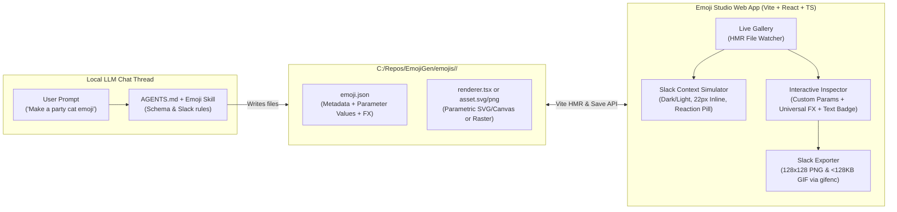

# EmojiGen — Local LLM Slack Emoji Studio Plan

## 1. Is This Possible? (Core Concept)

**Yes — and this workflow actually plays to an LLM's strongest capabilities.**

If an LLM only outputs flat raster images, a web app can only do surface-level edits (cropping, tinting, speed changes). **However**, if we design the project around a **Parametric Emoji Format** (declarative SVG / HTML5 Canvas animation modules + a JSON control schema, while also supporting imported PNG/GIF/WebP assets), we get the best of both worlds:

1. **LLM-Driven Creation via File System**: You ask a local LLM thread in this repo *"Make an animated 'deploying on Friday' dumpster fire emoji"* or *"Create a static 'LGTM' stamp emoji"*.
2. **Instant Hot-Reload Gallery**: The LLM writes a self-contained folder `emojis/<name>/` on disk. The web app watches `emojis/` and immediately displays the new emoji live without refreshing.
3. **Deep + Universal Modification in the Web App**:
   - **Emoji-Specific Controls**: Because the LLM defines named parameters (e.g. `flameColor`, `flameHeight`, `shakeIntensity`, `labelText`, `showSparkles`), the web app automatically generates sliders, color pickers, text inputs, and toggles to tweak the emoji's internal parts.
   - **Universal Studio Modifiers**: Even for static or raster emojis, the web app provides universal post-processing: animation wrappers (party rainbow cycle, intense shake, bounce, spin, pulse, wobble), bold text overlays (`LGTM`, `WIP`, `NO`), color/hue filters, crop/padding, and FPS/speed control.
4. **Guaranteed Slack Compatibility**: Slack enforces strict limits (`128×128px`, `<128 KB` file size, transparent background, and legibility at `22px` inline text size on both light and dark themes). The web app handles frame capture, palette quantization, and size optimization to export ready-to-upload **PNG** and **Animated GIF** files.

---

## 2. System Architecture



---

## 3. Recommended Tech Stack

- **Frontend & Dev Server**: **Vite + React 19 + TypeScript + Tailwind CSS**
  - Fast startup, instant Hot Module Replacement (`import.meta.glob`) whenever the LLM creates or edits an emoji file.
- **Persistence Bridge**: **Custom Vite Server Middleware plugin**
  - Allows the browser UI to `POST /api/emojis/:slug/save` when you tweak sliders, colors, or create a variant in the web app, writing changes directly back to `emojis/<slug>/emoji.json` and saving exported `.png`/`.gif` files to `emojis/<slug>/exports/`.
- **Rendering & Export Pipeline**:
  - **Parametric SVG & Canvas 2D**: Deterministic frame-by-frame rendering Driven by a normalized progress clock `t ∈ [0, 1)`. Because animation is a pure function of `t`, the web app can scrub any frame on a timeline and render crystal-clear frames for GIF export at any FPS.
  - **`gifenc`**: Lightweight, fast pure-JS GIF encoder with palette quantization and transparency support to keep animated GIFs well under Slack's `128 KB` limit.
- **LLM Instructions (`AGENTS.md` + `.agents/skills/create-emoji/SKILL.md`)**:
  - Built-in instructions and templates in the repository so any local LLM session immediately knows how to generate new emojis or edit existing ones when prompted.

---

## 4. The Emoji Format (`emojis/<slug>/`)

Each emoji lives in its own folder under `emojis/<slug>/`:

```text
emojis/
  party-parrot-blob/
    emoji.json          # Metadata, default parameter values, universal FX settings
    renderer.tsx        # Parametric SVG/Canvas render function (or static.svg / image.png)
    exports/            # Generated Slack-ready 128x128 .gif and .png files
```

### How Parametric Controls Work
In `emoji.json` / `renderer.tsx`, an emoji declares its customizable parameters:
- **`color`**: Color picker (e.g., `bodyColor`, `accentColor`, `glowColor`)
- **`number` (slider)**: Range slider (e.g., `speed`, `eyeSize`, `chaosLevel`)
- **`text`**: String input (e.g., `badgeText`, `signText`)
- **`boolean`**: Toggle switch (e.g., `showSunglasses`, `partyMode`)
- **`select`**: Dropdown (e.g., `expression: "happy" | "panic" | "cool"`)

Plus **Universal Modifiers** available on every emoji automatically:
- **Motion Wrapper**: `none`, `shake` (intensifies), `party` (rainbow hue cycle), `bounce`, `spin`, `pulse`, `wobble`, `glitch`
- **Banner / Badge Overlay**: Text, font style, text color, stroke color, position (`top`, `center`, `bottom`), background pill
- **Timing & Transform**: Duration / FPS, frame count, scale, rotation, flip X/Y, background color or transparent

---

## 5. Key Web App Features

1. **Emoji Gallery & Variant Manager**
   - Grid view of all generated emojis with live animation toggle, search, and tag filtering.
   - "Duplicate as Variant" button in the web app (e.g., turn a green `"LGTM"` emoji into a red `"BLOCKED"` emoji in 2 clicks and save it as a new emoji).
2. **Slack Context Simulator**
   - Preview the emoji side-by-side at:
     - **128×128px** (Studio canvas with optional pixel grid & safe-zone overlay)
     - **32px** (Jumbo Slack message when sent without text)
     - **22px** (Inline inside a realistic mock Slack message thread)
     - **16px** (Inside a Slack reaction pill like `[🎉 4]`)
   - Instant toggle between **Slack Dark Mode** (`#1A1D21`) and **Slack Light Mode** (`#FFFFFF`).
3. **Interactive Parameter & FX Studio**
   - Left/Right inspector panels separating **Emoji-Specific Parameters** (created by the LLM) and **Universal Studio Modifiers** (motion presets, text overlay, color grading, speed/timeline scrubbing).
4. **LLM Prompt Helper ("Copy Edit Prompt")**
   - If you want a structural change beyond sliders (e.g., *"Add a wizard hat to this emoji"*), a button in the web app copies a ready-to-paste prompt referencing `emojis/<slug>/renderer.tsx` for your local LLM thread.
5. **Slack Export & Size Optimizer**
   - One-click export to **PNG** (static) or **Animated GIF** (animated).
   - Live file-size badge (`e.g. 42.8 KB / 128 KB ✅`) with automatic frame-rate / color-palette optimization if an animation approaches Slack's 128 KB ceiling.

---

## 6. Implementation Phases

1. **Phase 1: Project Scaffolding & Core Schema**
   - Initialize Vite + React + TypeScript + Tailwind CSS in `C:\Repos\EmojiGen`.
   - Define the TypeScript interfaces in `src/types/emoji.ts` (`EmojiDefinition`, `ParamSchema`, `UniversalModifiers`) and Vite disk-persistence plugin (`vite-plugin-emoji-fs.ts`).
2. **Phase 2: Rendering Engine & GIF/PNG Exporter**
   - Build the deterministic `128×128` SVG-to-Canvas renderer with universal motion FX (party tint, shake, bounce, spin, pulse, glitch), badge text overlay, and `gifenc`-based animated GIF / PNG exporter.
3. **Phase 3: Emoji Studio Web UI**
   - Build the Gallery sidebar, Interactive Canvas + Timeline scrubber, Slack Context Simulator (Dark/Light inline message & reaction previews), and Dynamic Controls Inspector.
4. **Phase 4: Starter Emoji Pack & LLM Skill (`AGENTS.md`)**
   - Create a showcase pack of 6–8 diverse starter emojis (both static and animated: e.g., `ship-it-rocket`, `this-is-fine-fire`, `lgtm-stamp`, `party-blob`, `loading-brain`, `panic-button`) to demonstrate custom controls and animations.
   - Write `AGENTS.md` and `.agents/skills/emoji-generator/SKILL.md` so any future prompt in this repo can effortlessly generate new emojis.
